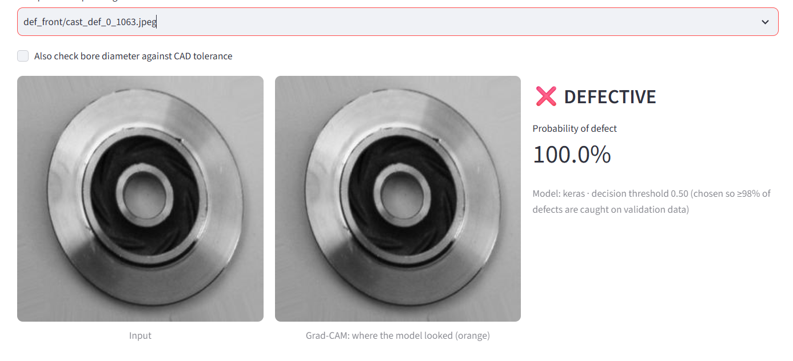
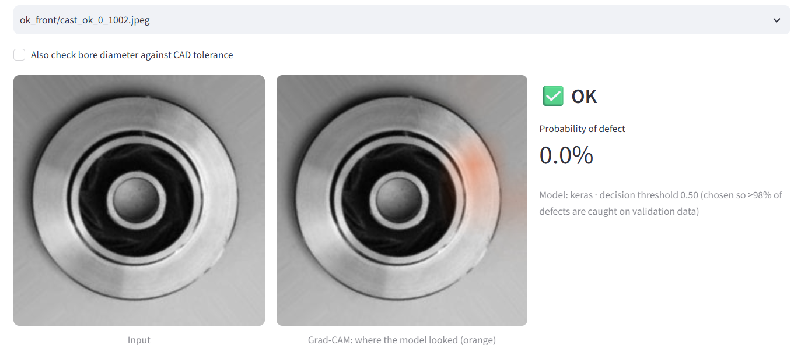
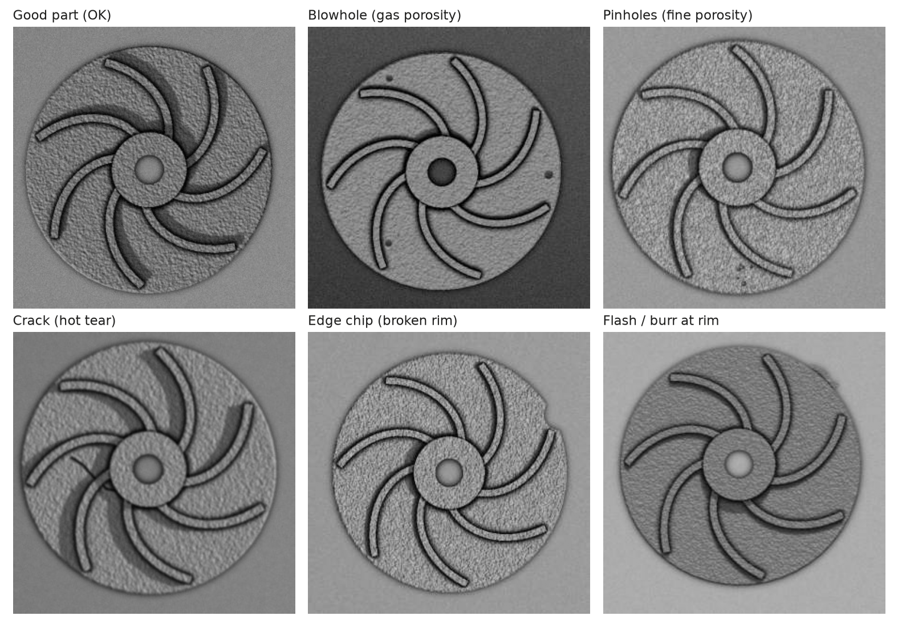

# AI Quality Inspection for Manufactured Parts

Detects casting defects in photos of pump impellers using **deep learning (TensorFlow/Keras and PyTorch)**, explains each decision with **Grad-CAM**, and uses a **parametric CAD model** to generate synthetic training images and to check part dimensions against drawing tolerances.

```
            ┌──────────────── CAD stage (CadQuery) ────────────────┐
 Design     │ parametric impeller ─► defects by boolean ops ─►     │
 dimensions │ mesh ─► physically-based rendering ─► labelled images│──┐
            └──────────────────────────────────────────────────────┘  │ synthetic data
 Real photos (Kaggle, 300×300 grayscale) ──────────────────────────────┤
                                                                       ▼
            ┌───────── Deep learning (same split, same metrics) ───────┐
            │ TensorFlow/Keras: MobileNetV2 transfer learning          │
            │ PyTorch:          ResNet18 transfer learning             │
            │ threshold tuned for ≥98% defect recall · Grad-CAM        │
            └──────────────────────────────────────────────────────────┘
                                   │
     TFLite export (edge) ◄────────┼────────► FastAPI REST API ──► Streamlit demo
                                   │
                    CAD dimension check: bore diameter vs 12 ± 0.5 mm
```

## Demo
| Defective part: flagged, with Grad-CAM heatmap | Good part |
|---|---|
|  |  |



## What makes it more than a tutorial
- **Two frameworks, fair comparison:** Keras and PyTorch get identical file lists, splits, metrics and reports.
- **CAD-generated training data:** defects are created on the 3D model (blowholes, pinholes, cracks, edge chips, flash), rendered with random lighting, texture and camera pose (*domain randomization*). Tested against **real** photos to measure the sim-to-real gap.
- **Quality-first metric:** the decision threshold is set on validation data so **≥98% of defective parts are caught**; a missed defect costs far more than a re-check.
- **Explainable:** Grad-CAM heatmaps show where the model saw the defect.
- **Dimensional inspection against CAD:** measures the shaft bore from the photo, using the hub as a built-in ruler; median error 0.25 mm at 300×300 px.
- **Deployable:** TFLite model (~3.8× smaller), REST API, web demo, 25 automated tests.

## Results
Google Colab (T4 GPU). All six models are tested on the same **715 real test photos** (453 defective, 262 good):

| Training data | Framework | Accuracy | Defect recall | Missed defects | False alarms |
|---|---|---|---|---|---|
| Real photos | Keras (MobileNetV2) | **99.58%** | 99.34% | 3 | **0** |
| Real photos | PyTorch (ResNet18) | 99.16% | 99.34% | 3 | 3 |
| CAD only | Keras | 62.66% | 94.26% | 26 | 241 |
| CAD only | PyTorch | 63.36% | 100%* | 0 | 262 |
| CAD + 10% real | Keras | 84.06% | 99.78% | 1 | 113 |
| CAD + 10% real | PyTorch | **98.46%** | **99.56%** | 2 | 9 |

\* Flagged every part as defective, so recall is meaningless here; read recall together with false alarms.

**Findings**
- Both frameworks exceed 99% on real photos; the 5× smaller MobileNetV2 is slightly ahead with zero false alarms, which suits edge deployment.
- Training on CAD images alone does not transfer to real photos (sim-to-real gap).
- CAD images plus only **10% of the real photos** reach 99.56% defect recall and 98.46% accuracy with PyTorch, so far fewer real defect photos are needed (Keras caught 99.78% but with 113 false alarms).

Also measured while building the project: **TFLite** 9.65 MB → 2.53 MB with the same decisions as Keras on all test images checked; **bore measurement** median error 0.22 mm, 90% of parts within ±0.5 mm (`scripts/measure_check.py`).

## Quick start: Google Colab (recommended, free GPU)
1. Open `notebooks/run_on_colab.ipynb` in Colab, set **Runtime → T4 GPU**.
2. Upload this project's zip (or clone your GitHub repo) and your `kaggle.json`.
3. Run all cells (~1 hour 15 minutes). Download `trained_models_and_results.zip` at the end.

## Run locally
```bash
python -m venv .venv && source .venv/bin/activate      # Windows: .venv\Scripts\activate
pip install -r requirements.txt

python scripts/download_data.py                         # 1. real dataset (needs kaggle.json)
python scripts/generate_cad_data.py                     # 2. CAD images (~10 min on 4 cores)
python scripts/run_experiments.py                       # 3. train 3 experiments x 2 frameworks (GPU recommended)
python scripts/export_tflite.py                         # 4. TFLite edge model
python scripts/compare.py                               # 5. results/comparison.md + .png
python scripts/measure_check.py                         # 6. CAD dimension-check accuracy

uvicorn api.main:app --reload                           # REST API  -> http://127.0.0.1:8000/docs
streamlit run app/streamlit_app.py                      # demo app  -> http://localhost:8501
python scripts/run_tests.py                             # 25 tests
```
Train a single model: `python scripts/train.py --framework pytorch --train-dir data/casting/casting_data/train --test-dir data/casting/casting_data/test`. Every setting is a flag (`--img-size`, `--epochs-head`, `--lr-finetune`…).

## Project structure
```
qi/
  cad/part.py        parametric impeller + 6 defect types (CadQuery, exports STEP)
  cad/render.py      z-buffer rasterizer, lighting, AO, shadows, domain randomization
  cad/generate.py    labelled synthetic dataset + metadata.csv (parallel)
  cad/measure.py     bore diameter vs CAD nominal and tolerance (sub-pixel circle fit)
  keras_model.py     MobileNetV2, 2-phase training, Grad-CAM, TFLite export
  torch_model.py     ResNet18, hand-written training loop, AMP, Grad-CAM (hooks)
  data.py            identical splits for both frameworks, no part leakage
  metrics.py         recall-first threshold, confusion matrix, ROC-AUC
  runner.py          one train+evaluate routine used by both frameworks
  inference.py       Keras / PyTorch / TFLite behind one interface (process-isolated)
scripts/             download, generate, train, run_experiments, export, compare, measure_check, tests
api/main.py          FastAPI: POST /inspect returns label, probability, Grad-CAM PNG, bore check
app/streamlit_app.py demo: inspect a photo, CAD defect lab, results
notebooks/           run everything on Colab
tests/               25 tests (CAD, metrics, both frameworks, API)
docs/                interview manual (PDF), figures, sample STEP files (open in FreeCAD)
```

## Design notes
- **Labels:** `0 = ok_front`, `1 = def_front` everywhere. The model outputs P(defective).
- **No leakage:** all photos of one CAD part stay on the same side of the train/validation split.
- **Threshold:** `min(0.5, t)` where `t` catches ≥98% of validation defects. It only ever moves down from 0.5.
- **Process isolation:** TensorFlow and PyTorch can crash when loaded into one Python process, so each training run and each model in the API runs in its own process.
- **Transfer learning:** ImageNet weights download automatically. `--weights none` trains from scratch (only useful for quick tests).

## Limitations
- Synthetic images are rendered top views of one part design; real lines need images from the real camera setup.
- Bore measurement assumes a near top-down view; accuracy scales with image resolution (~0.4 mm per pixel at 300 px).
- The Kaggle data has one part type and lighting setup; a new product or lighting needs new data or fine-tuning.

## Data credit
Real images: *Casting product image data for quality inspection*, published on Kaggle by user `ravirajsinh45` (`ravirajsinh45/real-life-industrial-dataset-of-casting-product`). Check the dataset page for its licence before redistributing images.
